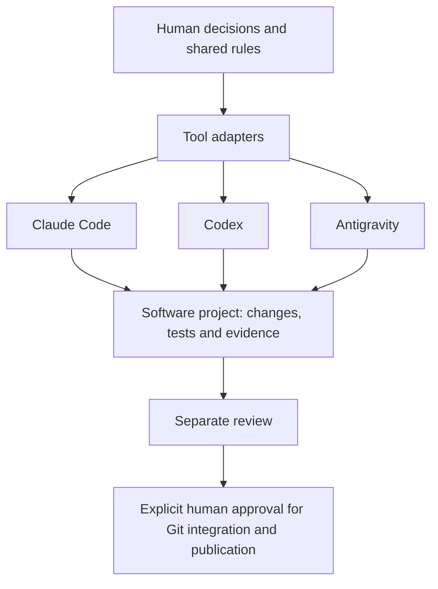

# AI-Workflow

**AI-assisted software development with human oversight and control**

## Overview
AI-Workflow is a personal learning and experimentation project for organizing AI-assisted development. It separates shared rules, tool-specific adapters, independent review, and explicit human decisions. It was configured and developed with AI assistance; it is not an autonomous software factory or a security product.

The public overview and this installation summary are in English. Operational instructions, existing code comments and detailed technical documentation are intentionally maintained in French.

## Key Features
- Shared rules for scoped work, preservation of pre-existing changes, proportionate validation and evidence reuse.
- Claude Code adapter with a targeted Git hook, native permission examples, a dedicated reviewer definition and status/notification components.
- Codex adapter with targeted native rules and a restricted native-review launcher.
- Antigravity adapter with explicitly documented differences in confinement and permission behavior.
- Git-state fingerprinting and offline synthetic test harnesses.

The components are supplied as source and configuration fragments. Historical qualification is documented separately from tests run on this public edition. Cross-provider review handoffs are coordinated by a human; they are not an implemented automatic orchestration service.

## Architecture


Shared rules live in `AI_WORKFLOW.md` and `architecture/`; adapters in `adaptateurs/`; project templates in `modeles-projet/`. Detailed operation is documented in `documentation/`.

## Supported Tools
| Adapter | Available components | Important limitation |
|---|---|---|
| Claude Code | Instructions, permission fragment, Git hook, reviewer, skills, status and notifications | Bash is not inherently read-only; the hook does not parse all shell behavior |
| Codex | Instructions, native rules, review launcher, skills and notifications | Native rules cover selected command prefixes; human STOPs also rely on instructions |
| Antigravity | Instructions, permission examples and skills | The documented default profile is broad-access, not strict confinement |

Historical campaigns cover Claude Code 2.1.280, Codex CLI 0.160.0 and Antigravity 1.2.6, with an additional Claude 2.1.289 delta recorded in the historical reports. Local executable paths were observed for 2.1.296 and 0.161.0 during preparation; that observation is not functional requalification. Model names and availability are provider-dependent.

## Human Oversight
The workflow requires an agreed scope before implementation. Staging, commits, publication and sensitive branch integration require separate human approval. A technical permission or accepted plan is not blanket permission for later Git operations. Reviewers should be distinct from the implementer and must not correct the sources under review.

## Safety Mechanisms
Native permissions, sandbox settings, a targeted Claude Git hook and Codex prefix rules provide layered, limited protection. They do not control every shell alias, variable, subprocess or command form. The Claude hook removes heredoc bodies from its analysis; all active heredoc bodies are excluded. This is a coverage gap when a body is interpreted by a shell/interpreter (quoted or unquoted delimiter), or when an unquoted body contains shell substitutions. This edition preserves the hook's behavior and documents that gap.

The Claude reviewer lacks Edit/Write tools but retains Bash: non-modification also depends on instructions and before/after checks. A read-only filesystem sandbox does not guarantee confidentiality or prevent every network transmission. Provider sessions may send source code and prompts to external services. Use only data you are authorized to share; never treat this project as a secret scanner or a universally enforced security boundary.

## Adapter dependencies and differences
The distributed Claude instructions select Antigravity for final external review, plus Codex for high-risk work. A Claude-only installation must consciously adapt that reviewer policy before use; no automatic substitute is supplied.

| Mechanism | Claude | Codex | Antigravity |
|---|---|---|---|
| Force push | Canonical rules and bounded hook deny | No equivalent blanket native rule in this fragment; human STOP | No equivalent force-push deny in this fragment; human STOP |
| Secret paths | Selected native Read/Edit rules, not exhaustive | No universal secret scanner | Explicit native path prefixes only; `**` globs not established effective; terminal excluded |

Secret lists differ: Claude does not enumerate Azure, gcloud, kube and shell histories here; Antigravity does not enumerate Codex authentication or a generic secrets directory. Review these gaps before installation. The author’s broad Antigravity profile is not recommended as a confidentiality boundary. Operational filters have not been harmonized or strengthened.

The public Java repositories linked in the **Example Workflow** section were verified as public via the GitHub API on 17 October 2026. Their visibility can change.


## Installation
Work from a local checkout of this edition and review the selected adapter before installing it. No automatic global installer is provided.

1. Use macOS for the documented setup. Install macOS Command Line Tools providing working `/usr/bin/git` and `/usr/bin/python3`, a POSIX shell and `jq`. The offline suites were run with Python 3.12.14 and 3.13; adapter hooks explicitly use the system interpreter, which must be checked separately. Install and authenticate only the AI tools you intend to use, following their official instructions. Provider access may require a paid plan or API usage; this repository does not include accounts or model access.
2. Run the offline tests below before changing any personal settings. Review all adapter files and the [capability limitations](documentation/claude/MECANISMES.md).
3. Choose a stable local checkout. The adapters expect `~/.ai-workflow` to resolve to it. Inspect that path first. Create a link only when it is absent; if it exists, stop and use a separate account for experimentation. Do not replace another workflow installation.
4. Back up only the settings/files that you will change, to a private directory outside this checkout. Keep backups out of Git. Use the [Claude inventory](adaptateurs/claude/INVENTAIRE.md) or [Codex inventory](adaptateurs/codex/INVENTAIRE.md) as the explicit copy list. Copy individual static files only after comparing existing targets; never recursively copy a global configuration directory. Preserve the relative review-launcher link if installing Codex.
5. For Claude, manually merge only reviewed `fragment_settings` keys from `adaptateurs/claude/configuration-workflow.json`. For Codex, manually apply only the selected `parametres` from its manifest to `~/.codex/config.toml`. These JSON manifests are not complete runtime settings files. Do not replace personal settings, credentials, MCP connections, plugins or project state. Read the [Antigravity guide](documentation/antigravity/README.md) before opting into its broad-access profile.
6. Validate the merged JSON/TOML, compare the exact changes and open a new tool session in a disposable project with fictitious data. Confirm effective permissions before real development. Offline tests do not prove live provider behavior.
7. To roll back, restore only the backed-up files/keys, after checking for intervening user changes. Remove only newly installed files recorded in your installation notes. Never delete a whole global configuration directory or overwrite newer settings blindly.

See the French [controlled installation guide](documentation/INSTALLATION.md) for details. Notifications use macOS `osascript`; the launchers use qualified Unix utility paths. Full Linux/Windows compatibility is not claimed. No installation into the author's real settings was performed for this edition.

## Example Workflow
The [Spring Boot case study](examples/gestion-personnes/README.md) describes a historical experiment on a disposable copy of [gestion-personnes](https://github.com/jordankeyanfe586/gestion-personnes): a disabled-person update bug, tests, separate review, explicit human approvals and Git integration. The reported 26-test result belongs to that historical clone, not a new test run or a claim about today's public Java repository. The other related learning project is [bankkonto-jdbc](https://github.com/jordankeyanfe586/bankkonto-jdbc).

## Testing and Validation
Offline checks do not start provider sessions or execute the command strings supplied to the Git hook:
```sh
python3 -B tests/claude/outils/test_barriere_git.py
python3 -B tests/claude/outils/test_bancs.py
python3 -B tests/public/test_public.py
```
The last two commands create disposable temporary fixtures. Test results, environment and limitations are recorded in [public-edition validation](documentation/VALIDATION_PUBLIQUE.md). Historical reports under `tests/` retain their dates and outcomes but have anonymized local references. Some original raw traces no longer exist. Live provider qualification, full installation and cross-platform operation are separate from offline validation.

## Known Limitations
- Human STOPs and behavioral rules are not universal technical locks.
- The hook's shell analysis is deliberately incomplete; interpreted heredoc bodies, unquoted substitutions and indirection require particular care.
- No automatic cross-provider review, universal secret protection, full Windows/Linux support or current-version provider qualification is claimed.
- Historical private commit references are provenance notes, not commits imported into this public edition.

## AI Contributions
The project was configured and developed with AI agents under human oversight. Known role attributions are recorded in historical reports. Authorship of every line and the owner's personal understanding of every component cannot be inferred from Git metadata alone. Understanding and checking proposed changes remains the human user's responsibility.

## Project History
The workflow was originally developed in a private repository. This is a selected, anonymized public edition with an independent future Git history. No private Git objects, remotes or reflogs were copied, and no historical commits are fabricated. The original environment remains separate.

## License
This public edition is licensed under the [MIT License](LICENSE), selected by the owner on 17 October 2026. See [provenance and third-party scope](documentation/LICENCE_ET_PROVENANCE.md). Provider tools, services and trademarks remain subject to their own terms.
